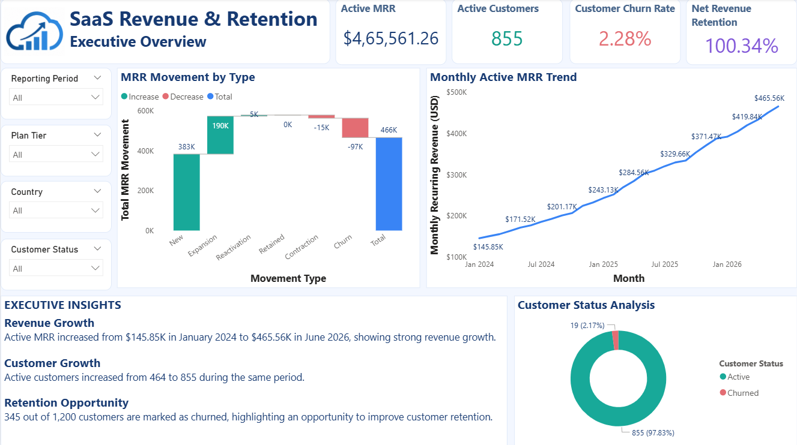
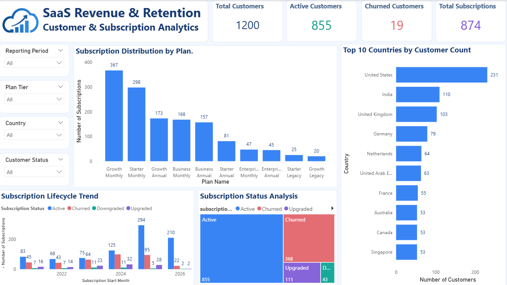
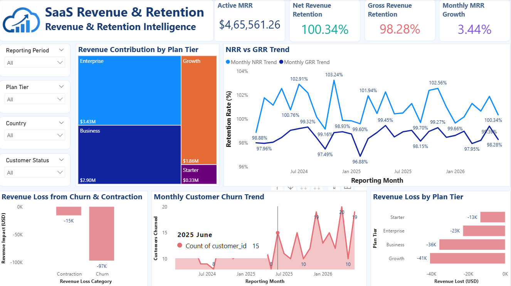
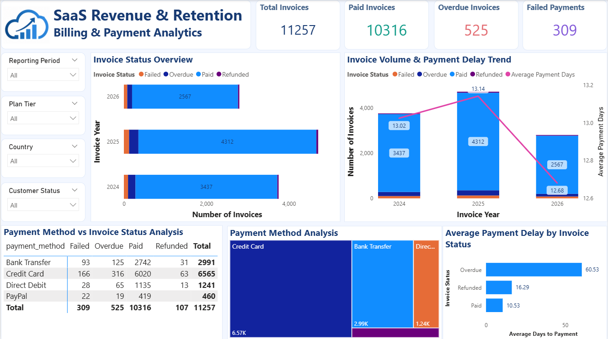
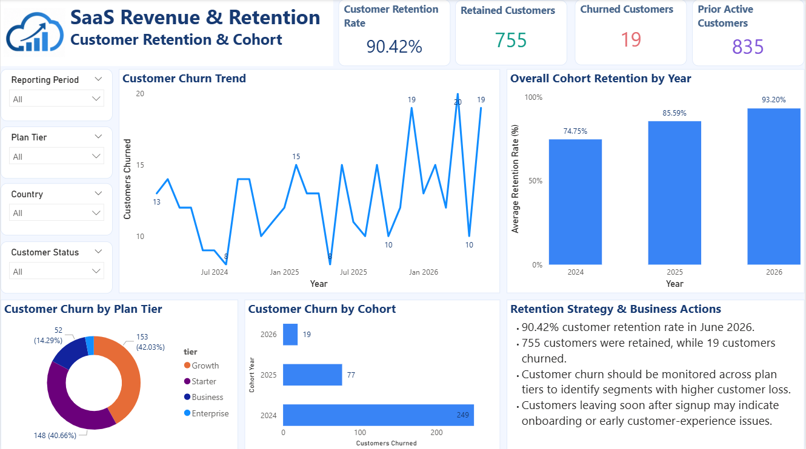

# 📊 SaaS Subscription Revenue & Retention Intelligence

### Turning subscription data into actionable business decisions

An end-to-end Data Analytics project that explores SaaS revenue performance, customer retention, subscription movements, churn, and billing operations using **Python, SQL, SQLite, and Power BI**.

---

## 🚀 Project Overview

SaaS businesses depend on recurring revenue and long-term customer relationships. Understanding why revenue changes, how customers behave, and where payment issues occur is essential for sustainable growth.

This project analyzes subscription and billing data to uncover business trends, monitor key performance indicators, and support data-driven decisions.

**The goal:** Transform raw SaaS data into meaningful business insights through data preparation, SQL analysis, and interactive Power BI dashboards.

## 🎯 Business Objectives

- Monitor Monthly Recurring Revenue (MRR) and revenue growth.
- Understand customer churn and retention patterns.
- Analyze subscription upgrades, downgrades, and cancellations.
- Evaluate Net Revenue Retention (NRR) and Gross Revenue Retention (GRR).
- Identify invoice payment trends and billing issues.
- Provide actionable recommendations to improve customer retention and recurring revenue.

## 🛠️ Tools & Technologies

| Technology | Purpose |
|---|---|
| Python | Data cleaning and preparation |
| SQL | Business analysis and data validation |
| SQLite | Database management |
| Power BI | Interactive dashboards and visualization |
| Excel | Data inspection and supporting analysis |

## 📂 Project Structure

```text
SAAS-REVENUE-RETENTION-INTELLIGENCE/
│
├── data/
│   ├── raw/
│   └── processed/
│
├── notebooks/
│   └── Python analysis notebooks
│
├── sql/
│   └── SQL analysis and validation queries
│
├── powerbi/
│   └── Power BI dashboard file and screenshots
│
├── outputs/
│   ├── charts/
│   ├── reports/
│   └── summary_tables/
│
├── docs/
│
├── README.md
├── requirements.txt
└── .gitignore
```

## 📈 Power BI Dashboard

The project contains five interactive dashboard pages:

| Dashboard | What it analyzes |
|---|---|
| 01. Executive Overview | MRR, active customers, churn rate, and NRR |
| 02. Customer & Subscription Analytics | Customer status, subscription status, plans, and countries |
| 03. Revenue & Retention Intelligence | MRR trends, revenue movements, NRR, GRR, and churn |
| 04. Billing & Payment Analytics | Invoice status, payment methods, payment delays, and billing trends |
| 05. Customer Retention Insights | Retention rate, churn trends, and customer cohorts |

### 📸 Dashboard Previews

#### 01. Executive Overview


#### 02. Customer & Subscription Analytics


#### 03. Revenue & Retention Intelligence


#### 04. Billing & Payment Analytics


#### 05. Customer Retention Insights


**Interactive analysis:** Reporting Period, Plan Tier, Country, and Customer Status filters are included across the dashboards.

## 🔍 Key Business Findings

Based on the analyzed dataset:

| Metric | Result |
|---|---:|
| Total Customers | 1,200 |
| Active Customers (June 2026) | 855 |
| Churned Customers | 345 |
| Total Subscriptions | 1,381 |
| Total Invoices | 11,257 |
| Active MRR (June 2026) | $465,561.26 |
| NRR (June 2026) | 100.34% |
| GRR (June 2026) | 98.28% |

### 💡 Business Insights

- Active MRR reached **$465.56K** in June 2026.
- NRR of **100.34%** indicates that expansion revenue slightly exceeded revenue lost from existing customers.
- GRR of **98.28%** indicates that most starting recurring revenue was retained before expansion.
- The customer base includes **345 churned customers**, highlighting the importance of retention strategies.
- Billing analysis helps identify overdue and failed invoices that may affect revenue collection.

## 💼 Business Recommendations

1. **Improve Onboarding:** Support new customers during their first months to encourage product adoption.
2. **Reduce Churn:** Monitor customer activity and proactively engage customers at risk of cancellation.
3. **Encourage Expansion:** Identify opportunities for suitable plan upgrades.
4. **Improve Payment Collection:** Use timely reminders and follow-ups for overdue or failed invoices.
5. **Monitor Retention:** Track NRR, GRR, and customer retention regularly to evaluate business performance.

## 📊 Dataset

The project uses the **SaaS Subscription & Churn Analytics Dataset** by `rivalytics` from Kaggle.

The dataset contains customer, subscription, plan, invoice, and monthly subscription records. It covers January 2024 to June 2026.

*Note: The findings represent the supplied dataset and should not be interpreted as actual results from a real SaaS company.*

## ▶️ Project Workflow

1. Data collection and inspection
2. Data cleaning and preparation using Python
3. Database creation and data analysis using SQL
4. Business metric calculation and validation
5. Interactive dashboard development using Power BI
6. Business insights and recommendations

## 🌟 Project Outcome

This project demonstrates practical Data Analyst skills, including:

- Data cleaning and preparation
- SQL querying and business analysis
- KPI development and validation
- Power BI dashboard development
- Customer retention and revenue analysis
- Translating data findings into business recommendations

---

**Developed as a Data Analytics Portfolio Project**

*Focus: SaaS Revenue Analytics | Customer Retention | Business Intelligence*
